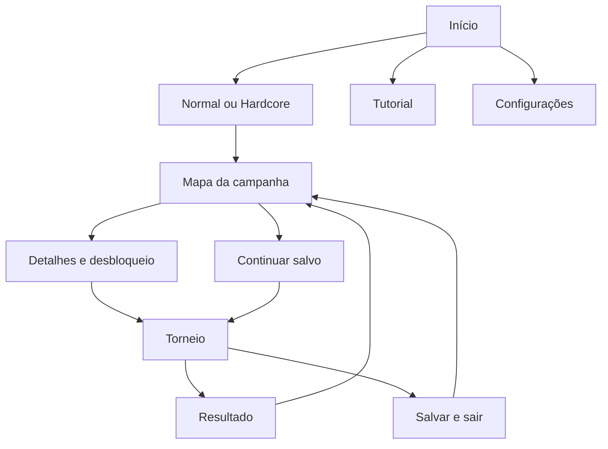

# Telas e navegação mobile

UX de release1.0.0, fechada sob delegação do autor. Escalas e aparência: `DESIGN.md`; textos e lições finais: `CONTEUDO_RELEASE.md`.



Mapa recebe o modo explicitamente, sem misturar saldos. Retomar/abandonar uma tentativa antes de iniciar outra naquela campanha; a outra permanece independente.

## Oito áreas principais

| Área | Conteúdo e comportamento |
|---|---|
| Início | Normal, Hardcore, Aprender, Configurações; `Continuar` quando existe save. Tutorial oferecido, pulável. |
| Mapa | Caminho vertical, saldo da campanha, mesas vencidas/abertas/bloqueadas; rolagem por janela de etapas. |
| Detalhes | Participantes, dificuldade relativa, stack igual, blinds, prêmio e passe. `Desbloquear por X` confirmado; `Jogar` gratuito após compra. |
| Mesa | Bots, board, pote, mão, turno, blinds e ações. Normal sem relógio; Hardcore com tempo e reserva. |
| Resultado | Vitória/derrota, prêmio, bônus e saldo confirmado; repetir, próxima mesa ou mapa. |
| Tutorial | Mãos guiadas, repetir/pular/revisitar, sem custo nem prêmio de campanha. |
| Regras/revisão | Ranking, termos e última mão, só com cartas reveladas. |
| Configurações | Áudio, vibração, naipes, texto, animações e créditos; preferências persistidas. |

## Esboço da mesa

```text
┌────────────────────────────┐
│ Mesa 12 · Normal · Pausa    │
│ Blinds 10/20 · Mão 4        │
│ Bot 1     Bot 2     Bot 3   │
│     Bot 4       Bot 5       │
│           Pote 240         │
│   [ ] [ ] [ ] [ ] [ ]     │
│ Bot 2 pagou 40             │
│       [sua] [mão]          │
│ Um par · Suas fichas: 900  │
│ [Quer uma dica? · custo]   │
│ [½ pote] [Pote] [Tudo]     │
│ [−] ───── valor ───── [+]  │
│ [Desistir] [Pagar] [Aumentar]│
└────────────────────────────┘
```

Estrutura, não coordenadas finais. Cinco bots em duas linhas 3+2, com stack e última ação visíveis; estilo/detalhes podem expandir ao toque. Texto ampliado compacta dados secundários e aumenta controles sem exigir rolar para agir. Carta pode ampliar por toque. Testar 360×640, 360×800, 412×915 lógicos e safe areas antes da arte final.

Presets obedecem ao motor. Confirmação de raise exibe total da rodada, não acréscimo ambíguo. Não mostrar raise mínimo impossível num all-in curto. Separar Fold do caminho do slider; não exigir gesto de arrastar para apostar.

## Ajuda, resultado e saída

- Resultado por mão em faixa curta; no showdown comparar mãos, em fold dizer que os outros desistiram. Potes separados podem ter diferentes vencedores, visíveis nos detalhes.
- Dica após8 s de tempo ativo no Normal: preço, confirmação e conteúdo voluntário. Uma compra por decision_id; pausa/checkpoint não invalidam nem cobram novamente. Sem dica no Hardcore; regras gratuitas sempre.
- Saldo insuficiente não bloqueia jogar: explicar o custo e permitir continuar sem dica.
- Pausa contém continuar, regras, salvar/sair e abandonar. Abandono confirmado encerra como derrota.
- Retomar do sistema exibe `Continuar` antes de reativar relógio. Pausa/regras congelam tempo, sem renovar reserva.
- Se já existe partida salva, tocar outra mesa oferece continuar ou abandonar a existente. Nunca sobrescrever silenciosamente.
- Falha no save deixa a revisão confirmada intacta e permite retry. Backup recuperado é informado; não apagar progresso silenciosamente.

## Tutorial de release

1. Cartas privadas/comunitárias e melhor combinação de cinco.
2. Check/call, pote e quantias destacados.
3. Bet/raise/all-in, stack e risco de eliminação.
4. Showdown, ranking e kicker; vitória também por fold adversário.
5. Mini-torneio guiado, blinds e eliminação, seguido da primeira mesa.

Cenários/textos fechados em CONTEUDO_RELEASE.md, separados do RNG das campanhas. Não exigir suposta jogada estratégica perfeita. Validar com cinco iniciantes conforme gate R10: ao menos4 distinguem ações e concluem sem ajuda externa. Sem alegação estatística de retenção.
